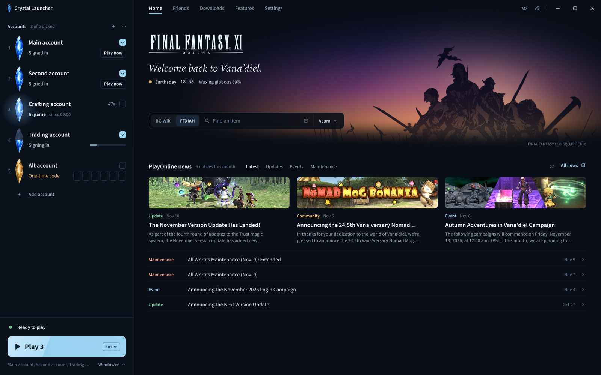
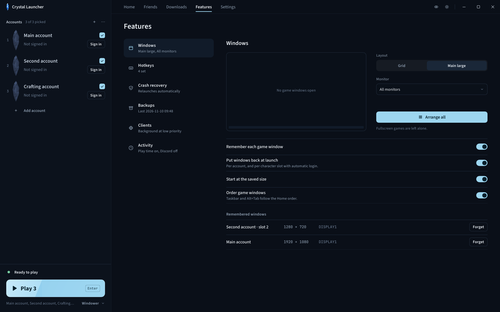

<p align="center">
  
</p>

<p align="center">
  A native Windows launcher for FINAL FANTASY XI. Sign in, update, multibox and set up the game in one app.
</p>

<p align="center">
  <a href="https://github.com/Offset437/FFXI-Crystal-Launcher/releases/latest"></a>
  <a href="https://github.com/Offset437/FFXI-Crystal-Launcher/releases"></a>
  
  <a href="LICENSE"></a>
</p>

<p align="center">
  <br>
  <sub>Screenshots use sample accounts and friends.</sub>
</p>

## Features

- Launch with vanilla FFXI, Windower 4 or Ashita v4, with a profile picker and optional character auto-login per account.
- Native PlayOnline sign-in, including one-time codes. Save an account's authenticator key and Crystal fills in the code for you.
- Accounts are signed in when Crystal opens, so Play starts the game right away.
- Multibox: per-account window layouts, Arrange all and Restore windows, Ctrl+Tab to cycle characters, crash and disconnect recovery, per-client priority and CPU affinity.
- PlayOnline friends, status and mail, with a privacy mode for streams and screenshots.
- FFXI and PlayOnline updater with file check, repair and resumable downloads. Supports POL 1.18.15f.
- Controller setup for Xbox, DualSense and ROG Xbox Ally, with a live input test.
- Graphics settings, with optional dgVoodoo and ReShade setup.
- Dark and light themes. English and Japanese.
- Game files are never modified. The game runs in Crystal's own 4 GB large-address-aware host.

| Account already signed in | Signing in from scratch |
|:---:|:---:|
| 0.4 s from Play to game start | 10–13 s from Play to game start |

<sub>Measured on 1.1.0 with Windower 4. Sign-in time depends on Square Enix's servers and your connection. Accounts with a one-time code sign in when you press Play.</sub>

<table>
  <tr>
    <td width="50%"></td>
    <td width="50%"></td>
  </tr>
  <tr>
    <td align="center"><sub>Friends, in privacy mode</sub></td>
    <td align="center"><sub>Window layouts</sub></td>
  </tr>
</table>

## Download

Get the latest build from [Releases](https://github.com/Offset437/FFXI-Crystal-Launcher/releases/latest).

| File | Use it when |
|---|---|
| `Crystal-Launcher-1.2.1-Setup.exe` | You want Desktop and Start menu shortcuts. Installs per user, no admin prompt. |
| `Crystal-Launcher-1.2.1.zip` | You want a portable copy. Unzip and run. |
| `SHA256SUMS` | You want to verify the download. |
| `launcher-update.json` | Never. The built-in updater reads it. |

If SmartScreen warns you, choose **More info**, then **Run anyway**. To check the file first, compare its hash with `SHA256SUMS`:

```powershell
Get-FileHash .\Crystal-Launcher-1.2.1-Setup.exe -Algorithm SHA256
```

Crystal updates itself. Every update is signed (Ed25519) and verified before it installs.

**Requirements:** 64-bit Windows 10 or later and a retail FFXI account. [Windower 4](https://www.windower.net/) and [Ashita v4](https://www.ashitaxi.com/) are optional. Game files are not included.

## Getting started

1. Open Crystal. It looks for your FFXI, PlayOnline, Windower and Ashita folders. Use **Browse** if it misses one.
2. No game installed yet? Open **Downloads**, get the official installer, install PlayOnline and FFXI, then run **Check files**.
3. Add your accounts with **Add account**, or **Import** your saved PlayOnline accounts.
4. Pick a launcher and profile, tick your accounts and press **Play**.

Close your games and sign out of PlayOnline before updating or repairing files.

## Privacy

- No telemetry or analytics. Accounts, settings and layouts stay on your PC.
- Game traffic is stock PlayOnline traffic. Hotkeys, layouts and recovery make no requests of their own.
- Square Enix files are never modified. The 4 GB host is built from this repository, not a patched `pol.exe`.
- Other connections are ones you use: PlayOnline news and the installer page, BG Wiki and FFXIAH lookups, GitHub for launcher updates and dgVoodoo, and reshade.me for ReShade.

Crystal is an independent project and can't speak for Square Enix's rules. Read their terms for your account, multiboxing and add-ons.

## Building

Needs Rust with the `i686-pc-windows-msvc` target, Python 3 and the Visual Studio C++ build tools.

```powershell
tools\build-release.ps1 -InstallerCompiler "C:\Program Files (x86)\NSIS\makensis.exe"
```

This builds the 32-bit game host, then the launcher with the host embedded. `-InstallerCompiler` is optional and builds Setup.exe with NSIS. Run `cargo test` for the tests.

## Support

[Open an issue](https://github.com/Offset437/FFXI-Crystal-Launcher/issues) with your Crystal version, launch method, what happened and how to reproduce it. Hide account details and private messages in screenshots and logs. For account or billing problems, contact [Square Enix support](https://support.na.square-enix.com/main.php?id=20&la=1).

## License

Crystal is an independent project, not affiliated with or endorsed by Square Enix, Windower or Ashita. Code and original SVG icons are [GPL-3.0-only](LICENSE), with no warranty; see [third-party notices](THIRD_PARTY.md). The code license does not cover Square Enix's game, artwork, logos, news images, music or trademarks.

FINAL FANTASY XI © 2002 - 2020 SQUARE ENIX CO., LTD. All Rights Reserved. FINAL FANTASY is a registered trademark of Square Enix Holdings Co., Ltd. PlayOnline and related marks belong to their respective owners. See the [FINAL FANTASY XI Materials Usage License](https://support.na.square-enix.com/rule.php?id=20&la=1&tag=authc).
