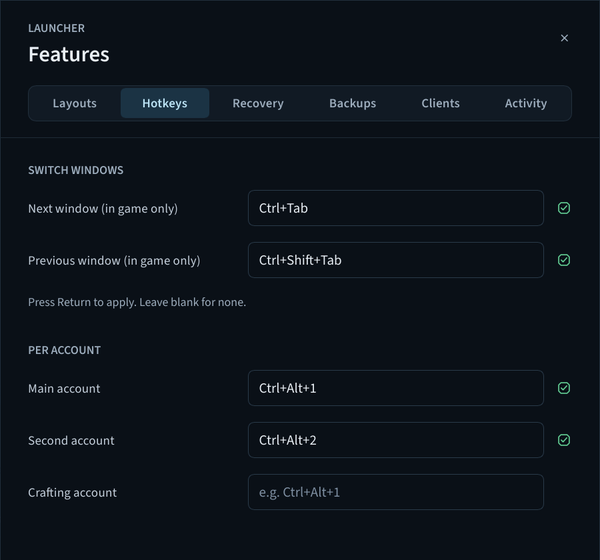
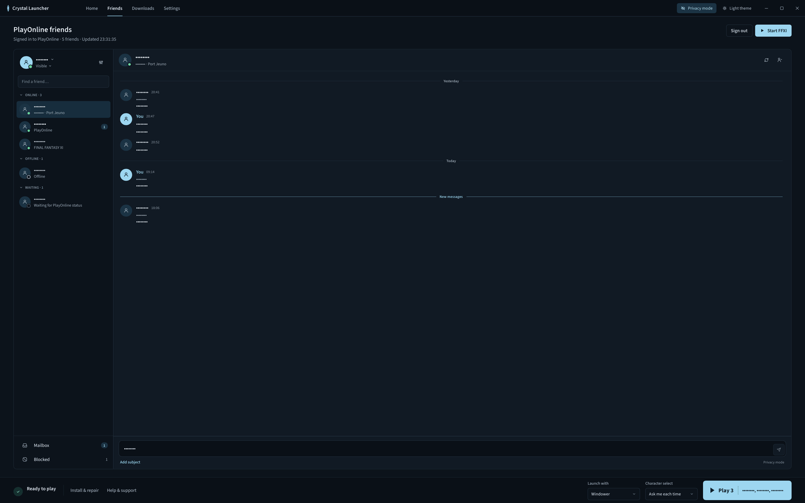
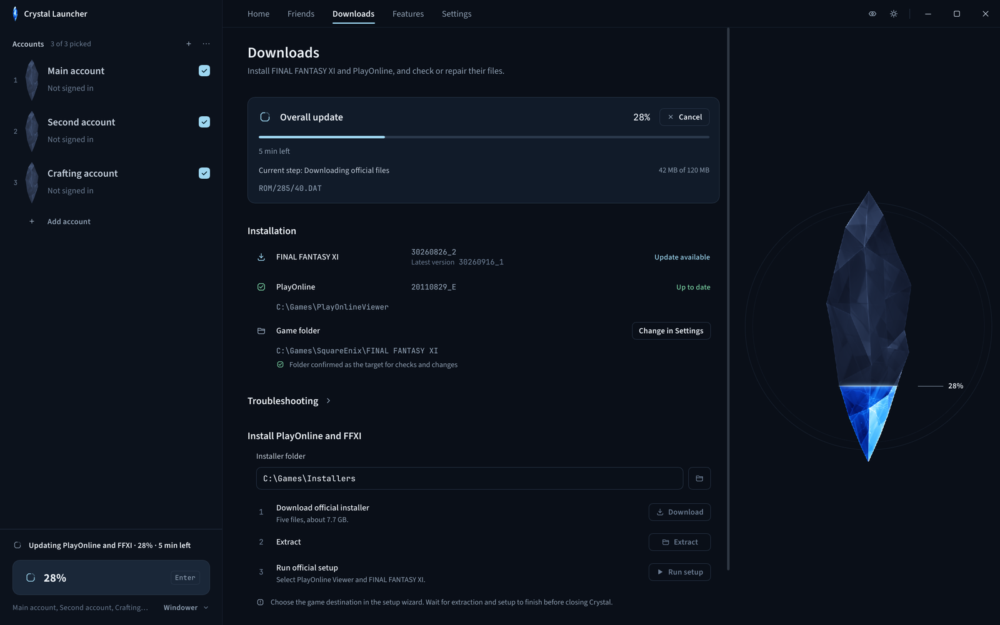
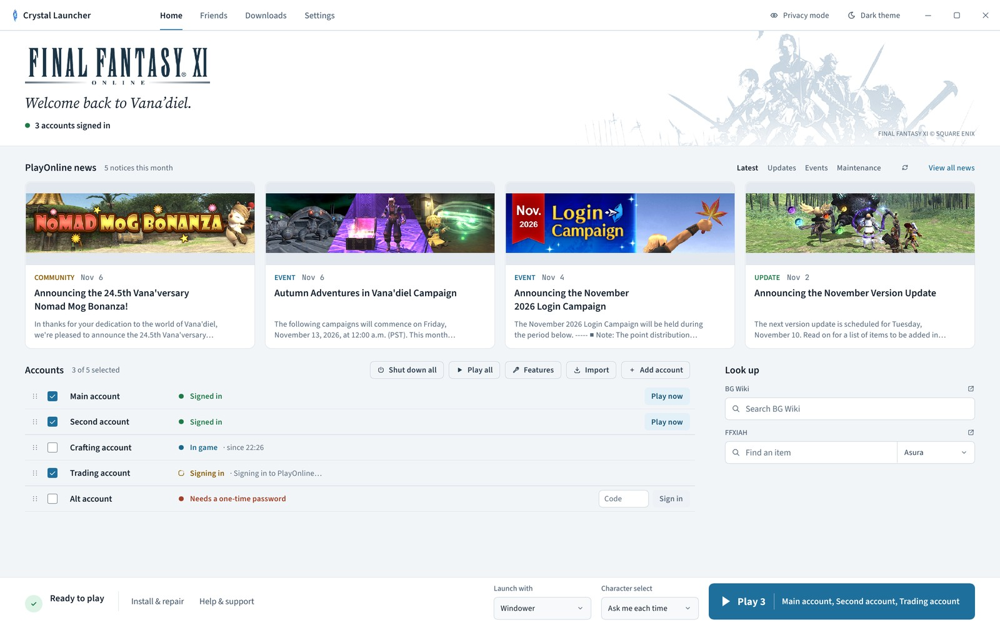
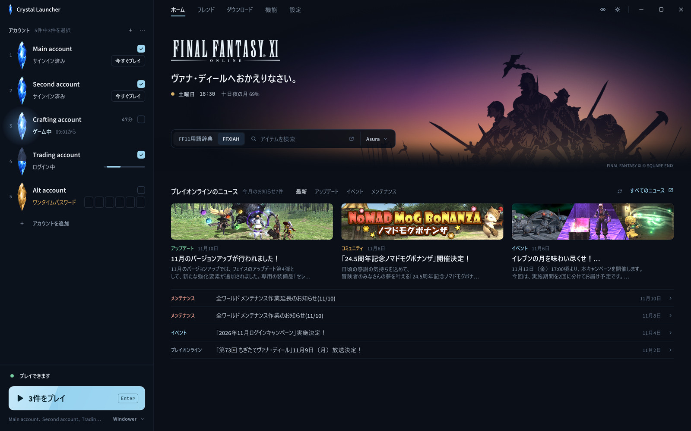

<p align="center">
  
</p>

<p align="center">
  Sign in, update, multibox and set up the game from one native Windows app.<br>
  Vanilla, Windower 4 or Ashita v4. Already signed in when you press Play. No telemetry.
</p>

<p align="center">
  <a href="https://github.com/Offset437/FFXI-Crystal-Launcher/releases/latest"></a>
  <a href="https://github.com/Offset437/FFXI-Crystal-Launcher/releases"></a>
  
  <a href="LICENSE"></a>
</p>

<p align="center">
  <a href="https://github.com/Offset437/FFXI-Crystal-Launcher/releases/latest"><b>Download for Windows</b></a>
  &nbsp;&middot;&nbsp; <a href="#getting-started">Getting started</a>
  &nbsp;&middot;&nbsp; <a href="#your-whole-party-one-key-apart">Multibox</a>
  &nbsp;&middot;&nbsp; <a href="#privacy-and-safety">Privacy</a>
  &nbsp;&middot;&nbsp; <a href="#faq">FAQ</a>
</p>

<p align="center">
  <br>
  <sub>Every screenshot in this README uses sample accounts and friends.</sub>
</p>

## From Play to Vana'diel in seconds

Crystal signs your accounts in to PlayOnline when it opens, and again a few seconds after a game closes. When you press **Play**, the sign-in is already done and the game starts straight away.

| 0.4 s | 10–13 s | 2–3 s |
|:---:|:---:|:---:|
| Play to game start<br><sub>account already signed in</sub> | Play to game start<br><sub>signing in from scratch</sub> | game start to the license screen<br><sub>FFXI's controller scan runs during sign-in, or not at all</sub> |

- **Warm sign-in** is on by default (*Settings → Sign accounts in when Crystal opens*). It is the same PlayOnline sign-in, done before you click instead of after.
- **Accounts with a one-time password** sign in when you press Play, since the code is needed then.
- **Even a cold Play is quick.** Each account's game host is started and waiting before you click, so most of those 10–13 s are Square Enix's sign-in servers.

<sub>Times measured on the 1.1.0 build with Windower 4. Server-side sign-in time varies with Square Enix's servers and your connection.</sub>

## The short answers

| Question | Answer |
|---|---|
| **Windower and Ashita?** | Yes. Vanilla, Windower 4 or Ashita v4, with a profile picker and optional character auto-login per account. |
| **PlayOnline sign-in?** | Native, including one-time codes. Friends, status and mail are built in too. |
| **Multibox?** | It is what Crystal is built for. Layouts, one-key switching, recovery, priority and CPU affinity. |
| **My game files?** | Never modified. The game runs in Crystal's own 4 GB large-address-aware host. |
| **Cost?** | Free and open source under GPL-3.0. |

## Your whole party, one key apart

Crystal remembers a window for every account, puts it back at launch, and **Arrange all** lines every client up at once. Switching characters is one key, and it only listens while a game window is in front.

<table>
  <tr>
    <td width="50%"></td>
    <td width="50%"></td>
  </tr>
  <tr>
    <td align="center"><sub><b>Ctrl+Tab / Ctrl+Shift+Tab</b> cycle characters in Home order</sub></td>
    <td align="center"><sub><b>Window layouts</b> per account, plus Arrange all</sub></td>
  </tr>
</table>

- **Optional keys per account** jump straight to one character.
- **Taskbar and Alt+Tab order follow Home order**, so what you see matches how you cycle.
- **Crash and disconnect recovery** for every client.
- **Per-client priority and CPU affinity**, so the character you are playing gets the CPU.
- **Backups** of your FFXI `USER` data, Windower settings and Ashita settings.
- **Toast notifications** and **play time** per account.
- **Optional Discord presence** ("via Crystal Launcher"), off by default, local IPC only.

## Friends, status and mail without opening PlayOnline

See who is online, keep a conversation going with unread badges, and read your PlayOnline mailbox from the same window you launch from. Privacy mode (shown here) masks names and messages for streams and screenshots.

<p align="center">
  
</p>

## Updates you can trust

File check, repair, resumable downloads and backups for FFXI and PlayOnline, with support for POL 1.18.15f. An interrupted download picks up where it stopped.

<p align="center">
  
</p>

## Pick up a controller

Set up Xbox, PlayStation (DualSense) and ROG Xbox Ally controllers with a live input test and bindings. Crystal itself can be driven with a controller too.

<p align="center">
  
</p>

## Your launcher, your way

<table>
  <tr>
    <td width="50%"></td>
    <td width="50%"></td>
  </tr>
  <tr>
    <td align="center"><sub><b>Dark and light</b> themes</sub></td>
    <td align="center"><sub><b>English and Japanese</b>, news included</sub></td>
  </tr>
</table>

Also in the box: PlayOnline news and maintenance notices, BG Wiki and FFXIAH lookup, graphics settings with optional dgVoodoo and ReShade setup, and a privacy mode that masks account details for streaming and screenshots.

<details>
<summary><b>Full feature list</b></summary>

**Launching:** Vanilla, Windower 4 and Ashita v4 · Windower/Ashita profile picker · optional character auto-login per account · native PlayOnline sign-in with one-time codes · Crystal's own 4 GB large-address-aware game host

**Multibox:** per-account window layouts and Arrange all · Ctrl+Tab / Ctrl+Shift+Tab in Home order, only while a game window is in front · optional keys per account · taskbar and Alt+Tab follow Home order · crash and disconnect recovery · USER, Windower and Ashita settings backups · toast notifications · per-client priority and CPU affinity · play time · optional Discord presence

**Game setup:** FFXI and PlayOnline updater with file check, repair, resumable downloads and backups · POL 1.18.15f · controller setup with live test and bindings · graphics settings · optional dgVoodoo and ReShade setup

**Around the game:** PlayOnline friends, status and mail · news and maintenance notices · BG Wiki and FFXIAH lookup · privacy mode · dark and light themes · English and Japanese · signed self-updates (Ed25519)

</details>

## Download

Get the latest build from [**Releases**](https://github.com/Offset437/FFXI-Crystal-Launcher/releases/latest). Requires 64-bit Windows 10 or later and a retail FFXI account; [Windower 4](https://www.windower.net/) and [Ashita v4](https://www.ashitaxi.com/) are optional.

| File | Use it when |
|---|---|
| `Crystal-Launcher-1.1.0-Setup.exe` | You want Desktop and Start menu shortcuts. Installs per user, no admin prompt. |
| `Crystal-Launcher-1.1.0.zip` | You want a portable copy. Unzip and run. |
| `SHA256SUMS` | You want to verify the download before running it. |
| `launcher-update.json` | Never; the built-in updater reads it. |

**SmartScreen warning?** Choose **More info**, then **Run anyway**. To check the file first, compare its hash with `SHA256SUMS`:

```powershell
Get-FileHash .\Crystal-Launcher-1.1.0-Setup.exe -Algorithm SHA256
```

Crystal updates itself, and every update is signed (Ed25519) and verified before it installs. Game files are not included.

## Getting started

1. **Open Crystal.** It looks for your FFXI, PlayOnline, Windower and Ashita folders. Use **Browse** if it misses one.
2. **No game yet?** Open **Downloads**, get the official installer, install PlayOnline and FFXI, then run **Check files**.
3. **Add your accounts** with **Add account**, or **Import** your saved PlayOnline accounts.
4. **Pick a launcher and profile**, tick your accounts, and press **Play**.

Close your games and sign out of PlayOnline before updating or repairing files.

## Privacy and safety

- **No telemetry, no analytics.** Accounts, settings, layouts and play time stay on your PC.
- **Stock traffic.** Game traffic is stock PlayOnline traffic. Hotkeys, layouts and recovery make no requests of their own.
- **Square Enix files are never modified.** The 4 GB host is Crystal's own executable, built from this repository, not a patched `pol.exe`.
- **Other connections are ones you use:** PlayOnline news and the official installer page, BG Wiki and FFXIAH lookups, GitHub for launcher updates and dgVoodoo, and reshade.me for ReShade.
- **Open source.** Read the code, build it yourself, check the release hashes.

## FAQ

<details>
<summary><b>Will Crystal get my account banned?</b></summary>

Crystal does not modify Square Enix's files and sends stock PlayOnline traffic, with no extra requests of its own. It is an independent project and cannot speak for Square Enix's rules, so read their terms for your account, multiboxing and add-ons.
</details>

<details>
<summary><b>Do my accounts and settings survive an update or reinstall?</b></summary>

Yes. They live in your Windows user data folder, not the install folder, so launcher updates and reinstalls leave them alone.
</details>

## Building from source

Needs Rust with the `i686-pc-windows-msvc` target, Python 3 and the Visual Studio C++ build tools.

```powershell
# Release package: the 32-bit game host, then the launcher with the host embedded
tools\build-release.ps1 -InstallerCompiler "C:\Program Files (x86)\NSIS\makensis.exe"
```

`-InstallerCompiler` is optional and builds Setup.exe with NSIS. Run `cargo test` for the tests.

<details>
<summary><b>Development build</b></summary>

```powershell
cd crystal-loader; cargo build --release --target i686-pc-windows-msvc --bin pol; cd ..
$env:CRYSTAL_LOADER_EXE = "$PWD\crystal-loader\target\i686-pc-windows-msvc\release\pol.exe"
cargo run
```

</details>

## Support

[Open an issue](https://github.com/Offset437/FFXI-Crystal-Launcher/issues) with your Crystal version, launch method, what happened and how to reproduce it. Hide account details and private messages in screenshots and logs. For account or billing problems, contact [Square Enix support](https://support.na.square-enix.com/main.php?id=20&la=1).

## License

Crystal is an independent project, not affiliated with or endorsed by Square Enix, Windower or Ashita. Code and original SVG icons are [GPL-3.0-only](LICENSE), with no warranty; see [third-party notices](THIRD_PARTY.md). The code license does not cover Square Enix's game, artwork, logos, news images, music or trademarks.

FINAL FANTASY XI © 2002 - 2020 SQUARE ENIX CO., LTD. All Rights Reserved. FINAL FANTASY is a registered trademark of Square Enix Holdings Co., Ltd. PlayOnline and related marks belong to their respective owners. See the [FINAL FANTASY XI Materials Usage License](https://support.na.square-enix.com/rule.php?id=20&la=1&tag=authc).
