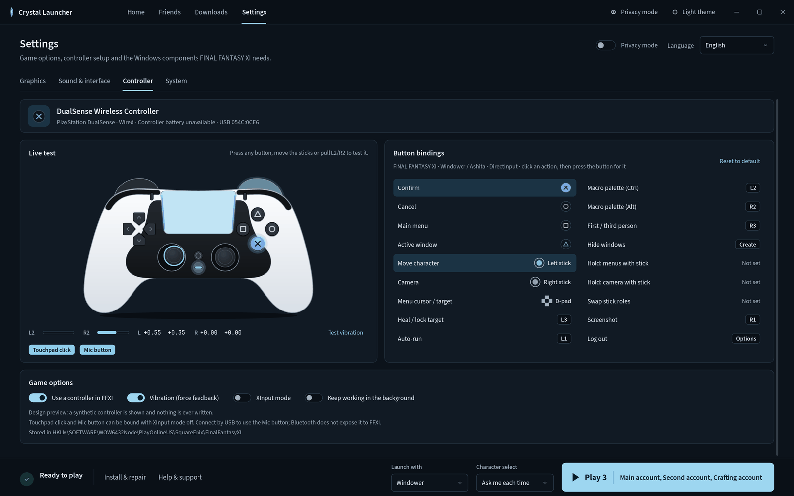
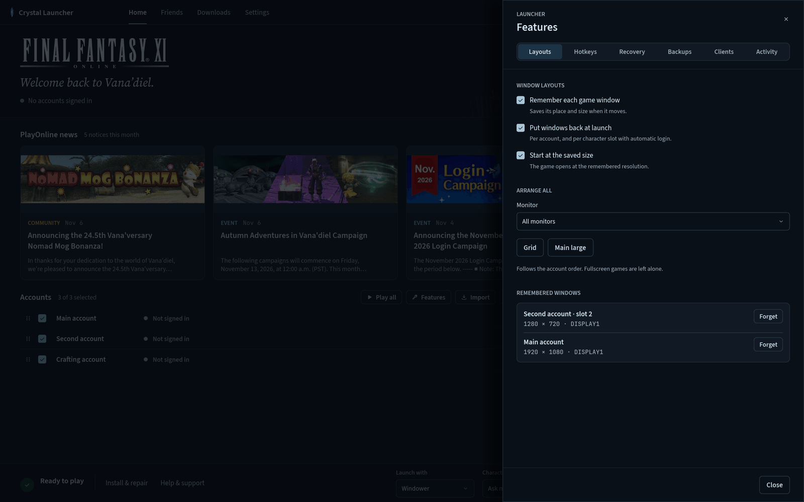

<p align="center">
  
</p>

<p align="center">
  One fast native app for signing in, multiboxing, updating and setting up FINAL FANTASY XI.
</p>

<p align="center">
  <a href="https://github.com/Offset437/FFXI-Crystal-Launcher/releases/latest"></a>
  <a href="https://github.com/Offset437/FFXI-Crystal-Launcher/releases"></a>
  
  <a href="LICENSE"></a>
</p>

<p align="center">
  
</p>

## Highlights

- **Starts instantly.** Opens in about 0.1 to 0.2 s and uses about 50 MB with the window open (previously 0.7 to 1.3 s and about 190 MB). It reopens from the notification area in about 30 ms.
- **Built for multiboxing.** Per-account window layouts, client-switch hotkeys, crash and disconnect recovery, and per-client priority and CPU affinity.
- **Vanilla, Windower or Ashita.** Pick a launcher and profile, tick your accounts, press Play.
- **Keeps the game current.** File check, repair, resumable downloads and backups for FFXI and PlayOnline.
- **Controller ready.** Setup for Xbox, PlayStation and ROG Xbox Ally controllers, and full controller navigation of Crystal itself.
- **Yours alone.** No telemetry. Accounts and settings never leave your PC.

<table>
  <tr>
    <td width="50%"></td>
    <td width="50%"></td>
  </tr>
  <tr>
    <td align="center"><sub>Controller setup with a live input test</sub></td>
    <td align="center"><sub>Per-account window layouts</sub></td>
  </tr>
</table>

<sub>Screenshots use sample accounts.</sub>

## Download

Get the latest build from [Releases](https://github.com/Offset437/FFXI-Crystal-Launcher/releases/latest).

- **Crystal-Launcher-x.y.z-Setup.exe** installs per user with Desktop and Start menu shortcuts.
- **Crystal-Launcher-x.y.z.zip** is the portable build: unzip and run, no install.

If Windows SmartScreen appears, choose **More info**, then **Run anyway**. Each release lists SHA-256 checksums in `SHA256SUMS`. Installed copies update themselves, and updates are signed (Ed25519) and verified before install.

Game files are not included. Saved accounts and settings survive launcher updates and reinstalls.

## Features

**Launching**
- Vanilla, Windower and Ashita, with a Windower or Ashita profile picker and optional character auto-login per account.
- Runs the game in Crystal's own 4 GB large-address-aware host. Supports POL 1.18.15f.
- PlayOnline friends, status and mail.

**Multibox**
- Per-account window layouts and Arrange all.
- Ctrl+Tab and Ctrl+Shift+Tab cycle your characters in Home order (only while a game is in front), plus optional keys per account.
- Taskbar and Alt+Tab order follow the Home order.
- Taskbar and Alt+Tab order that follows Home.
- Crash and disconnect recovery.
- One-click backups of FFXI `USER` data, Windower and Ashita settings.
- Notifications for mail and friends coming online.
- Per-client priority and CPU affinity, and play time.
- Optional Discord presence (off by default).

**Game setup**
- Updater for FFXI and PlayOnline: file check, repair, resumable downloads and backups.
- Controller setup for Xbox, PlayStation and ROG Xbox Ally.
- Graphics settings, with optional dgVoodoo and ReShade setup.

**Interface**
- Native, with dark and light themes, English and Japanese.
- News and maintenance notices, BG Wiki and FFXIAH lookup, and a privacy mode that hides account details.

## Requirements

- 64-bit Windows 10 or later
- A retail FFXI account. The US client is the tested setup.
- Optional: [Windower 4](https://www.windower.net/) or [Ashita v4](https://www.ashitaxi.com/)

## Getting started

1. Open Crystal. It looks for installed FFXI, PlayOnline, Windower and Ashita folders; use **Browse** if it misses one.
2. No game yet? Open **Downloads**, get the official installer, and install PlayOnline and FFXI. Then run **Check files**.
3. Add accounts with **Add account**, or **Import** saved PlayOnline accounts.
4. Pick a launcher and profile, tick your accounts, and press **Play**.

Close games and sign out of PlayOnline before updating or repairing files.

## Privacy & safety

- Accounts, settings, layouts and play time stay on your PC. There is no telemetry or analytics.
- Game traffic is stock PlayOnline traffic. Crystal makes no requests of its own for features such as hotkeys, layouts or recovery.
- Crystal never modifies Square Enix's files. The 4 GB host is Crystal's own executable, built from this repository, and never a patched copy of `pol.exe`.
- Other connections are the ones you use: news, BG Wiki and FFXIAH searches, GitHub for launcher updates and for dgVoodoo.
- Discord presence talks only to the local Discord app.

## Building from source

Needs Rust with the `i686-pc-windows-msvc` target, Python 3, and the Visual Studio C++ build tools.

```powershell
# Release package: the 32-bit game host, then the launcher with the host embedded
tools\build-release.ps1 -InstallerCompiler "C:\Program Files (x86)\NSIS\makensis.exe"

# Development
cd crystal-loader; cargo build --release --target i686-pc-windows-msvc --bin pol; cd ..
$env:CRYSTAL_LOADER_EXE = "$PWD\crystal-loader\target\i686-pc-windows-msvc\release\pol.exe"
cargo run
```

`-InstallerCompiler` is optional and builds Setup.exe with NSIS. Run `cargo test` for the tests.

## Support

[Open an issue](https://github.com/Offset437/FFXI-Crystal-Launcher/issues) with your Crystal version, launch method, what happened and how to reproduce it. Hide account details and private messages in screenshots and logs. For account or billing problems, contact [Square Enix support](https://support.na.square-enix.com/main.php?id=20&la=1).

## License

Crystal is an independent project, not affiliated with or endorsed by Square Enix, Windower or Ashita. Code and original SVG icons are [GPL-3.0-only](LICENSE), with no warranty; see [third-party notices](THIRD_PARTY.md). The code license does not cover Square Enix's game, artwork, logos, news images, music or trademarks.

FINAL FANTASY XI © 2002 - 2020 SQUARE ENIX CO., LTD. All Rights Reserved. FINAL FANTASY is a registered trademark of Square Enix Holdings Co., Ltd. PlayOnline and related marks belong to their respective owners. See the [FINAL FANTASY XI Materials Usage License](https://support.na.square-enix.com/rule.php?id=20&la=1&tag=authc).
